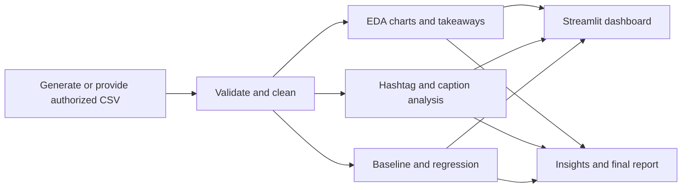
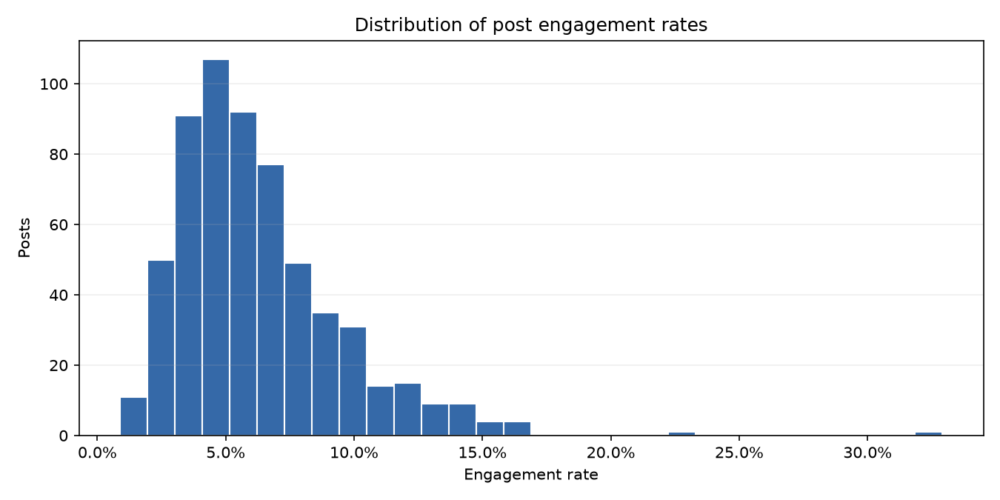

# Social Media Engagement Analysis

Explore post format, publishing time, hashtags and caption length against an engagement metric. This repository includes a synthetic dataset generator, reproducible analysis scripts, charts, a regression baseline comparison and an interactive Streamlit dashboard.

> **Data note:** the included dataset is synthetic and has deliberately simulated patterns. The analysis demonstrates a workflow; its findings are not recommendations for a real account.

## Workflow



## Quick start
```powershell
python -m venv .venv
.venv\Scripts\Activate.ps1
pip install -r requirements.txt
python src/generate_data.py
python src/clean.py
python src/analysis.py
python src/text_analysis.py
python src/model.py
streamlit run dashboard.py
```
On macOS/Linux, activate with `source .venv/bin/activate`. Run tests with `python -m pytest -q` from this folder. The data and report commands can also run independently after dependencies are installed.

The analysis command saves six chart images and chart-specific takeaways under
`reports/` after validating and cleaning the input. The takeaways describe
associations in this synthetic sample, not causal effects.
The text-analysis command writes hashtag frequency and caption-length summaries
and charts to `reports/`.
The modeling command compares a mean baseline with linear regression on a held-out
test split and writes metrics and coefficient summaries to `reports/`. The dashboard lets you filter by post type and date range. Generated charts and tabular results are committed for quick review.

## Sample results

These numbers come from the generated 600-post dataset and one seeded 80/20 holdout run.

| Measure | Observed result |
|---|---:|
| Median engagement rate | 5.58% |
| Highest mean format | Video, 8.54% (187 posts) |
| Highest observed hour | 18:00, 10.25% (21 posts) |
| Baseline test MAE | 0.02318 |
| Regression test MAE | 0.01782 |
| Regression test R² | 0.3927 |



See [chart takeaways](reports/chart_takeaways.md), [text analysis](reports/text_analysis_summary.md), [regression evaluation](reports/regression_evaluation.md), the [recommendations](INSIGHTS.md), and the [final report](reports/final_report.md).

## Folder map
| Path | Purpose |
|---|---|
| `docs/01_PROJECT_BRIEF.md` | Problem, users, scope, success criteria |
| `docs/02_REQUIREMENTS.md` | Must / should / could requirements and non-functional needs |
| `docs/03_ARCHITECTURE.md` | Design, components, tech stack |
| `docs/04_DATA.md` | Data sources, schema and data rules |
| `docs/05_ROADMAP.md` | Phase-by-phase build plan with checklists |
| `docs/06_TESTING_EVALUATION.md` | Test plan and evaluation metrics |
| `docs/07_RISKS_ETHICS.md` | Risks, mitigations, ethics notes |
| `docs/08_DELIVERABLES_CHECKLIST.md` | Definition of done |
| `docs/09_REPORT_TEMPLATE.md` | Final report / presentation outline |
| `INSIGHTS.md` | Evidence-backed observations and experiment ideas |
| `dashboard.py` | Interactive Streamlit explorer |
| `src/` | Starter source code |
| `tests/` | Automated tests |
| `data/` | Datasets (git-ignored except samples) |
| `notebooks/` | Exploration notebooks |
| `reports/` | Generated charts, summaries and model results |

## Tech stack
- Python 3.10+
- pandas, numpy
- matplotlib / seaborn
- vaderSentiment (optional)
- scikit-learn
- Streamlit or Power BI (optional dashboard)
- pytest
