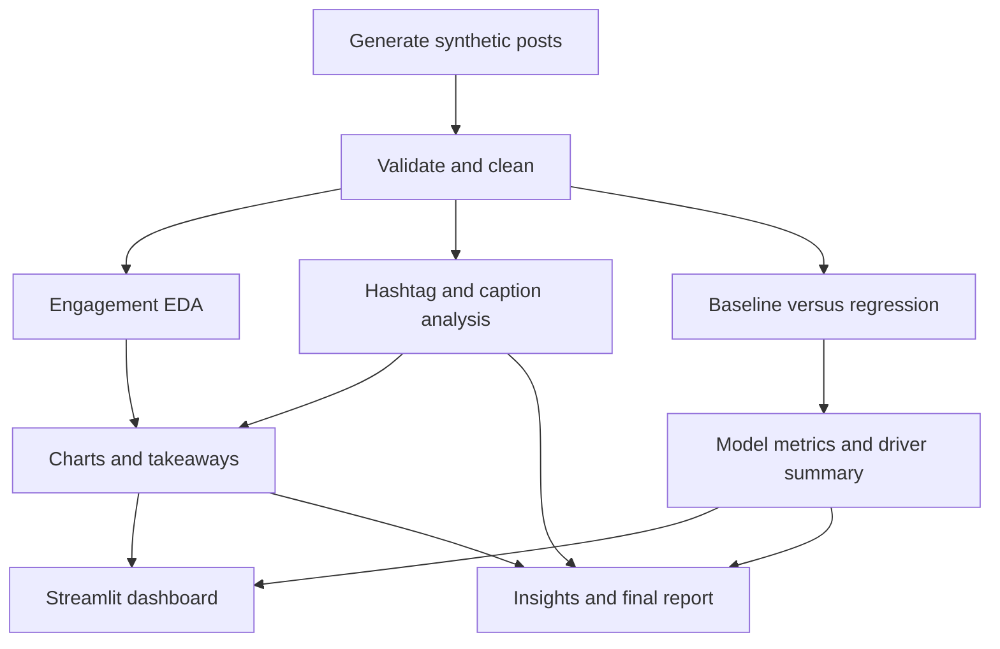
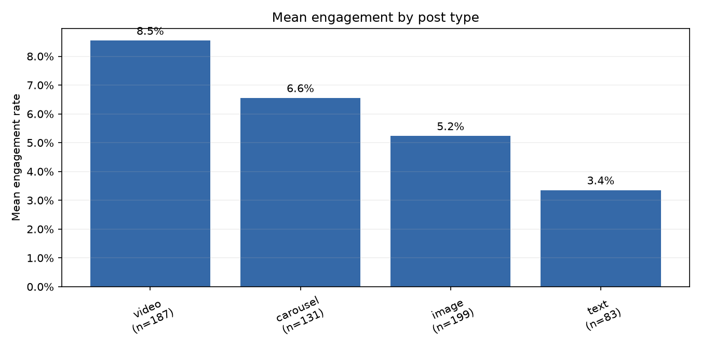
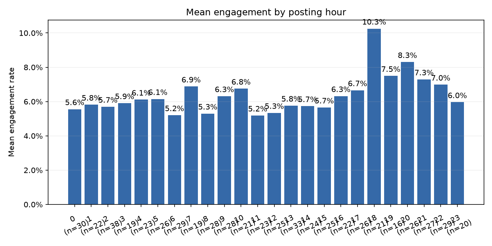
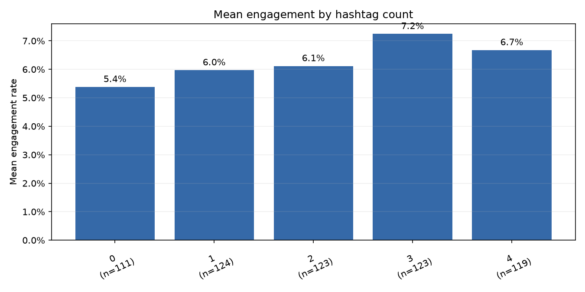

# Social Media Engagement Analysis

An exploratory analytics project for understanding how post format, publishing time, hashtags, and caption length relate to social media engagement. It includes a reproducible synthetic data generator, a cleaning and analysis pipeline, charts, a held-out regression comparison, and an interactive Streamlit dashboard.

> **Important:** The included data is synthetic, and the generator intentionally simulates engagement patterns. Results demonstrate the workflow; they are not evidence about real users and should not be used as real account recommendations.

## Contents

- [Features](#features)
- [Workflow](#workflow)
- [Quick start](#quick-start)
- [Run the dashboard](#run-the-dashboard)
- [Sample results](#sample-results)
- [Charts](#charts)
- [Method and interpretation](#method-and-interpretation)
- [Project layout](#project-layout)
- [Testing](#testing)
- [Limitations and responsible use](#limitations-and-responsible-use)

## Features

- Generate a deterministic 600-post synthetic dataset for offline demonstrations.
- Validate and clean posts while retaining a separate raw input file.
- Calculate engagement rate as `(likes + comments + shares) / followers`, with zero for zero followers.
- Explore engagement across post type, hour, weekday, hashtag count, hashtags, and caption length.
- Create six EDA charts with sample-aware takeaways and top/bottom post rankings.
- Compare a linear regression with a training-mean baseline on a seeded holdout set.
- Filter an interactive dashboard by post type and publication date.
- Export charts, summaries, rankings, and model metrics under `reports/`.

## Workflow



## Quick start

Python 3.10 or newer is recommended. From the repository root:

```powershell
python -m venv .venv
.venv\Scripts\Activate.ps1
python -m pip install -r requirements.txt
python src/generate_data.py
python src/clean.py
python src/analysis.py
python src/text_analysis.py
python src/model.py
```

On macOS or Linux, activate the environment with `source .venv/bin/activate` instead. Each analysis script writes its results under `reports/`.

## Run the dashboard

```bash
streamlit run dashboard.py
```

The dashboard opens in a browser. Use the sidebar to filter by post type and publication date, then explore engagement summaries, text summaries, and observed top/bottom posts. Generate the dataset and analysis outputs first using the quick-start commands.

## Sample results

These measured values are from the generated 600-post dataset and one seeded 80/20 random holdout split (480 training rows, 120 test rows).

| Measure | Result |
|---|---:|
| Posts analyzed | 600 |
| Median engagement rate | 5.58% |
| Middle 50% of engagement rates | 4.08%–7.74% |
| Highest mean format | Video: 8.54% (`n=187`) |
| Highest observed posting hour | 18:00: 10.25% (`n=21`) |
| Baseline test MAE | 0.02318 |
| Regression test MAE | 0.01782 |
| Regression test RMSE | 0.02263 |
| Regression test R² | 0.3927 |

The regression beat the mean baseline on this holdout. The result is a demo measurement on synthetic data, not a guarantee of predictive performance on real posts.

## Charts

| Engagement rate distribution | Mean engagement by post type |
|---|---|
|  |  |

| Mean engagement by posting hour | Mean engagement by hashtag count |
|---|---|
|  |  |

More charts and results:

- [Weekday chart](reports/by_weekday.png)
- [Hashtag chart](reports/by_hashtag.png)
- [Caption length chart](reports/caption_length.png)
- [Chart-specific takeaways](reports/chart_takeaways.md)
- [Hashtag and caption summaries](reports/text_analysis_summary.md)
- [Regression evaluation](reports/regression_evaluation.md)
- [Recommendations and experiment ideas](INSIGHTS.md)
- [Final report](reports/final_report.md)

## Method and interpretation

Engagement rate is calculated per post using the project formula above. The regression predicts engagement rate from post type, weekday, posting hour, hashtag count, and caption word count. One-hot encoding and scaling are fitted inside the training pipeline; results are evaluated on a held-out set and compared with a baseline that predicts the training-set mean.

Group averages and regression coefficients describe associations. They do not establish that changing a format, posting time, or caption will cause engagement to change. A low sample count can make a group mean unstable; chart labels include group sizes for context.

## Project layout

```text
├── dashboard.py              # Streamlit interface
├── src/
│   ├── generate_data.py       # Deterministic synthetic data generator
│   ├── clean.py               # Validation and cleaning
│   ├── analysis.py            # Engagement features and chart entry point
│   ├── charts.py              # EDA visualizations and rankings
│   ├── text_analysis.py       # Hashtag and caption summaries
│   └── model.py               # Baseline and regression evaluation
├── tests/                     # Unit and analysis tests
├── data/                      # Local data; generated files are git-ignored
├── reports/                   # Charts, summaries, and measured results
├── docs/                      # Project brief, requirements, design and report docs
└── INSIGHTS.md                # Evidence-based observations and experiment ideas
```

## Testing

Run the automated suite from the project root:

```bash
python -m pytest -q
```

The tests cover the engagement formula, zero-follower handling, hashtag extraction, cleaning rules, group-count reconciliation, ranking distinctness, text summaries, and regression holdout outputs.

## Limitations and responsible use

- The generated posts are simulated, not a sample of a real platform or audience.
- The synthetic generator deliberately encodes patterns; this project does not claim real-world causal or forecasting performance.
- VADER sentiment is listed as an optional dependency but was not run in the reported results.
- For real data, use only account exports you are authorized to analyze, remove personal identifiers, and follow the relevant platform terms and data-protection requirements.

Review [project risks and ethics](docs/07_RISKS_ETHICS.md) before using account data.
