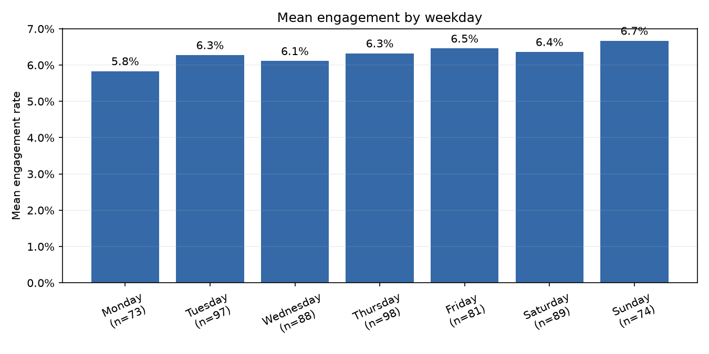
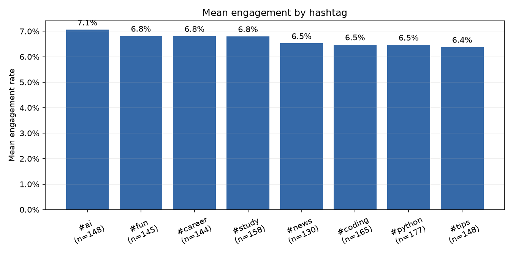

# Chart takeaways

These findings describe associations in this dataset; they do not establish causes.

## Engagement distribution

Median engagement is 5.58%; the middle half of posts ranges from 4.08% to 7.74%.

## Post format

video posts have the highest mean rate (8.54%; n=187).

## Posting hour

The strongest observed hour is 18:00 (10.25%; n=21).

## Weekday

Sunday has the highest mean rate by weekday (6.67%; n=74).

## Number of hashtags

Posts with 3 hashtags have the highest mean by hashtag count (7.24%; n=123).

## Hashtag

#ai has the highest observed hashtag mean (7.06%; n=148).
