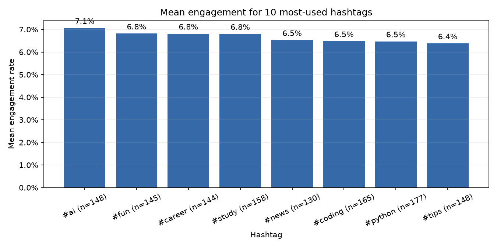
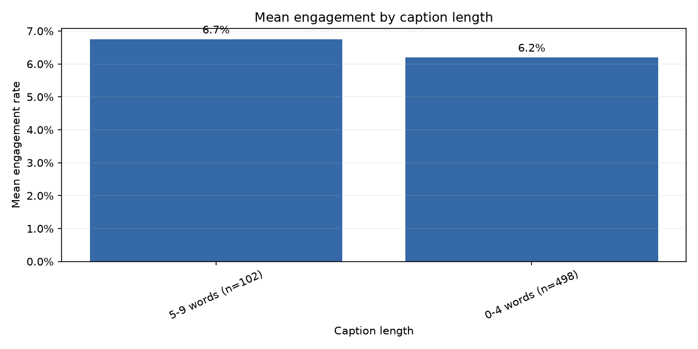
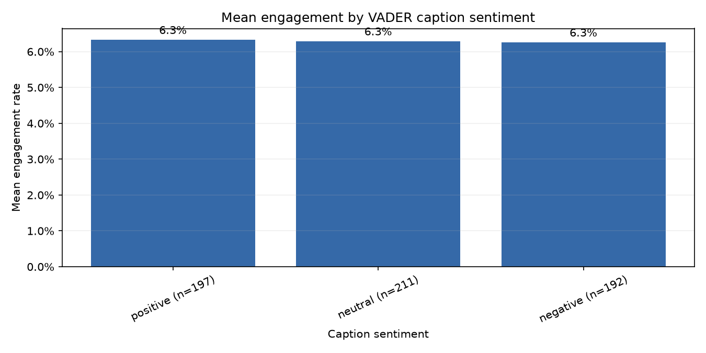

# Text analysis

Hashtag and caption patterns are descriptive associations in this dataset; they do not show that text causes engagement.

- 8 unique hashtags appear; 1215 tagged-post occurrences were counted.
- Most common hashtag is #python (n=177; mean ER 6.47%).
- Caption length is measured in words; 3 words is the median.
- VADER sentiment labels: negative 192, neutral 211, positive 197.

## Hashtag engagement

## Caption length

## Caption sentiment

VADER uses compound-score thresholds of -0.05 and +0.05. These lexicon-based labels can miss context, sarcasm, and domain-specific language.

