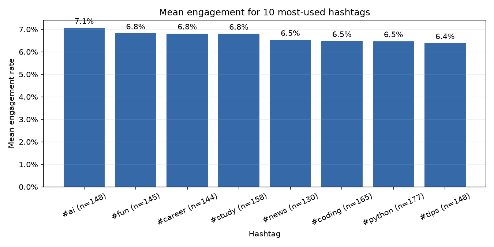
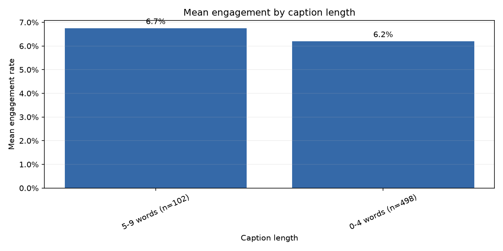

# Text analysis

Hashtag and caption patterns are descriptive associations in this dataset; they do not show that text causes engagement.

- 8 unique hashtags appear; 1215 tagged-post occurrences were counted.
- Most common hashtag is #python (n=177; mean ER 6.47%).
- Caption length is measured in words; 3 words is the median.

## Hashtag engagement

## Caption length

